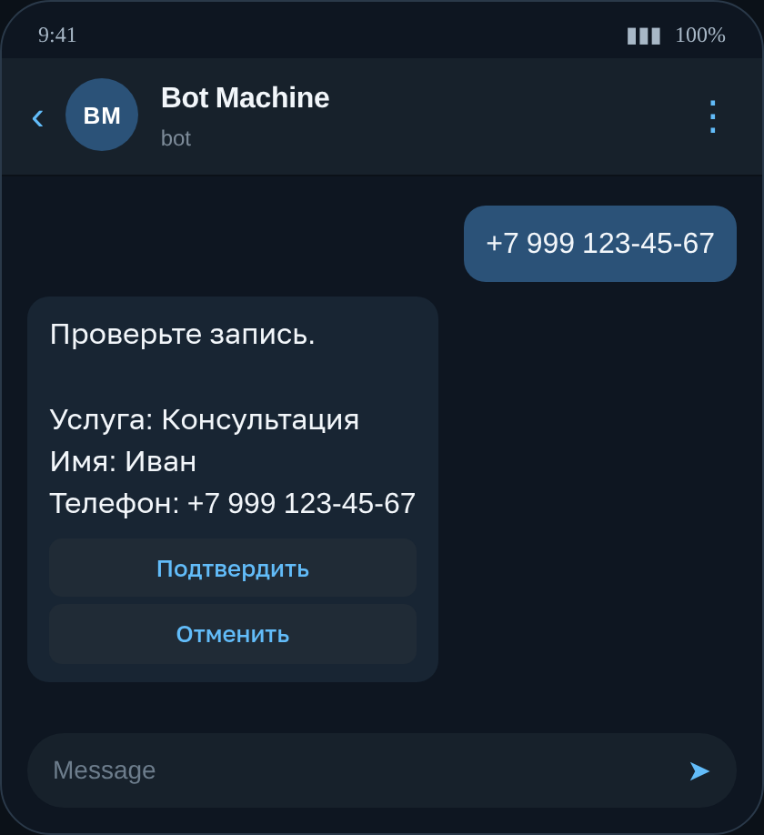

# Bot Machine

**Low-code framework for Telegram bots: flow, view, command.**

[](#запуск)
[](#как-устроено)
[](#почему-low-code)
[](#тесты)
[](LICENSE)

**[Открыть документацию →](https://jefo.github.io/bot-machine/)**



---

## Документация

Полная документация: **[jefo.github.io/bot-machine](https://jefo.github.io/bot-machine/)**

- [Быстрый старт](https://jefo.github.io/bot-machine/getting-started.html)
- [Flow и состояния](https://jefo.github.io/bot-machine/concepts/flows.html)
- [Справочник API](https://jefo.github.io/bot-machine/api/reference.html)
- [Ограничения](https://jefo.github.io/bot-machine/limits.html)

## Что это

Bot Machine — фреймворк, в котором бот собирается из трёх понятных частей:

- **Flow** — состояния и переходы, обычный объект;
- **View** — функция, которая получает данные и возвращает текст и кнопки;
- **Command** — бизнес-действие с Zod-схемой на входе.

Роутер, сессии, callback-кнопки и текстовые сценарии уже внутри. Новый экран — это новый ключ в объекте flow, а не ещё одна ветка `if` в обработчике.

```ts
export const flow = createFlow("appointment", {
  index: {
    component: async () => ({
      text: "Запись на приём",
      reply_markup: new Keyboard()
        .text("Записаться", "book")
        .text("Не сейчас", "cancel")
        .inline()
    }),
    onAction: {
      book: {
        command: createCommand({
          name: "startBooking",
          input: z.object({}),
          execute: async () => {}
        }),
        nextState: "service"
      }
    }
  },
  service: {
    // ...
  }
});
```

---

## Почему low-code

Не drag-and-drop, а **low-code для кода и AI-агентов**:

- сценарий читается как дерево состояний, а не как набор обработчиков;
- у каждой команды есть машинно-читаемый вход и выход;
- переходы типизированы: `createFlow` знает список состояний;
- view отделён от логики, как компонент в React;
- роутер и сессия не пишутся заново в каждом боте;
- AI-агенту проще менять flow, view и command, потому что границы явные.

Для заказчика это означает: изменения в боте локализованы, сценарий можно прочитать, а тесты проверяют не «нажалась ли кнопка», а переходы, сессии и маршрутизацию.

---

## Что внутри

- **FlowController** — конечный автомат с `onAction` и `onText`.
- **Router** — Express-подобные `onCommand`, `onText`, `onCallbackQuery`, middleware.
- **Session** — in-memory по умолчанию, Redis-хранилище в комплекте.
- **Context** — `reply`, `editMessageText`, `deleteMessage`, `answerCallbackQuery`, `enterFlow`.
- **Keyboard** — fluent API для inline и reply-клавиатур.
- **Text** — форматирование HTML без ручной сборки строк.
- **UI-kit** — базовые и e-commerce компоненты.
- **Logger** — pino с pretty-выводом в development.

---

## Запуск

```bash
bun install
bun test
bunx tsc --noEmit
bun run demo
```

`bun run demo` проигрывает запись на приём в консоли: старт → услуга → имя → телефон → подтверждение → готово.

Для реального Telegram-бота нужен токен:

```bash
BOT_TOKEN=123456:AA... bun run examples/telegram.ts
```

---

## Тесты

```text
108 pass
0 fail
185 expect() calls
6 snapshots
```

Покрыто:

- переходы flow и `nextState`;
- callback- и text-паттерны с параметрами;
- `onEnter`-запросы и передача props в view;
- роутер: команды, callback, текст, middleware, fallback;
- сессии: загрузка, сохранение, удаление;
- клавиатуры, форматирование текста, UI-kit;
- полный сценарий записи на приём.

---

## Как устроено

```text
src/
├── flow.ts          конечный автомат
├── router.ts        Express-подобный роутер
├── core.ts          createQuery / createCommand
├── context.ts       Telegram-контекст
├── session.ts       сессии и Redis
├── keyboard.ts      клавиатуры
├── text.ts          форматирование
├── logger/          pino
└── ui-kit/          готовые компоненты
```

Поток:

```text
Telegram update
  → Router
  → middleware (session)
  → FlowController
  → onAction / onText
  → Command
  → onEnter Query
  → View
  → Telegram payload
```

---

## Ограничения

- **Код, не визуальный редактор.** Flow описывается в TypeScript.
- **Нужны TypeScript и Zod.** Это осознанный входной барьер.
- **Telegram-контекст.** Ядро завязано на Telegram update; другие каналы — через адаптер.
- **In-memory сессии по умолчанию.** Redis-хранилище есть, но не включено.
- **Один процесс.** Нет распределённых блокировок и очередей.
- **Нет CRM и аналитики.** Только диалог и бизнес-команды.
- **Нет LLM-runtime.** Фреймворк помогает AI-агенту писать код, но не вызывает модель сам.
- **Нет версионирования flow.** Миграции активных диалогов не реализованы.

---

## Происхождение

Это портфолио-снимок стабильной версии **0.1.11** из `kaizin-lab/bot-machine` — npm-пакета `@bot-machine/telegram-sdk`.

Оригинальный репозиторий: https://github.com/kaizin-lab/bot-machine  
npm: https://www.npmjs.com/package/@bot-machine/telegram-sdk

В снимок добавлен сценарий записи на приём и консольное демо, чтобы фреймворк можно было проверить без токена и без Telegram.

---

## Что дальше

- JSON-загрузчик flow для генерации из AI/визуального редактора.
- Визуальный редактор состояний.
- Postgres/Redis для сессий и истории.
- Больше готовых компонентов: формы, пагинация, подтверждения.
- Мультиканальный контекст: Telegram, WhatsApp, веб.
- Аналитика воронки по состояниям.
- Версионирование flow и миграции.

---

## Лицензия

MIT.
